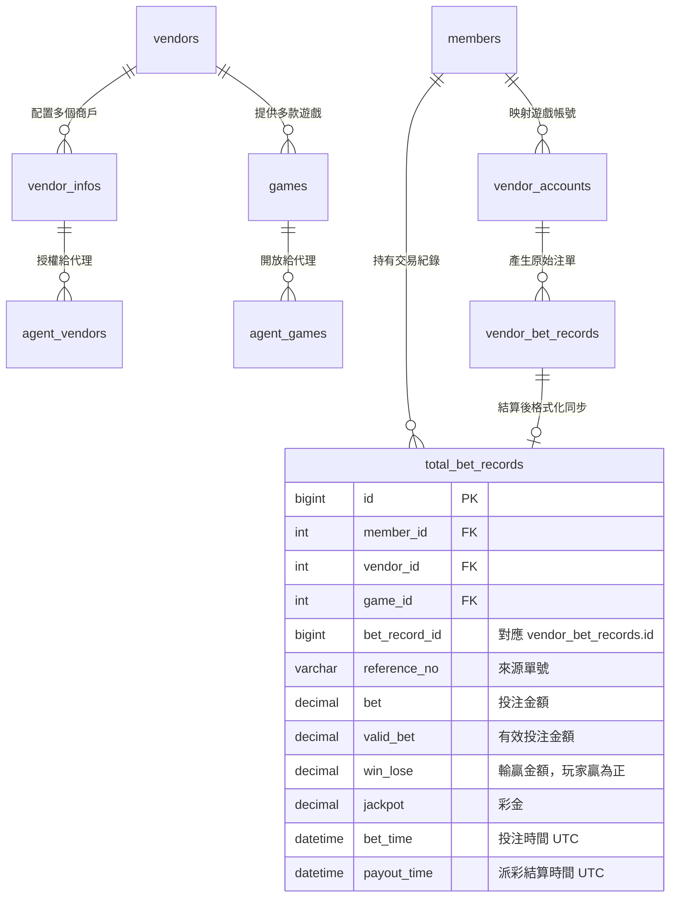

# 遊戲商接入完整操作流程（無縫錢包）

## 文件版本

最新版本：**v1.3**（2026-10-08）— 配置步驟改以 game-integration skill 為準，移除重複的舊流程文件。

## 概述

本文檔說明如何把採用**無縫錢包**機制的遊戲商接入系統。在這個機制底下，玩家遊玩時不需要自己轉帳，遊戲商會把每一次投注與派彩即時回調過來，由系統直接異動平台餘額。

### 名詞對照

名詞定義以 repo 根目錄的 [`GLOSSARY.md`](../../GLOSSARY.md) 為準，本節不重複定義。這裡只列**三方文件與代碼裡會看到的英文對應我方哪個正式名**，讀對接文件時照著查。

| 三方文件／代碼裡的說法 | 我方正式名 | 一句話 |
| :--- | :--- | :--- |
| Single Wallet、Seamless Wallet | **無縫錢包** | 額度只有我方這一個錢包、完全由我方控管，玩家每次投注與派彩都由遊戲商即時回調過來異動餘額 |
| Transfer Wallet | **轉帳錢包** | 另一種對接方式：玩家進遊戲前先把餘額轉進遊戲商那邊，離開時再轉回來 |
| vendor | **遊戲商** | 提供遊戲給我方會員玩的第三方公司（例如 PG、AG、Saba） |
| vendor info | **遊戲商戶** | 我方在某一家遊戲商那邊開的一組身分，持有該身分的憑證、固定對應一種商戶幣別 |
| bet | **投注** | 玩家在遊戲中下注，遊戲商發回調請求平台扣款 |
| settle | **派彩** | 遊戲結果產生後平台付給玩家的金額，遊戲商發回調請求平台加錢 |
| cancel bet | **取消投注** | 遊戲商撤銷先前的投注，把扣掉的金額還給玩家 |
| unsettle | **取消派彩** | 遊戲商撤銷先前的派彩，把已經發出去的金額收回 |
| rollback、refund | **退款** | 錢退回的通稱。⚠️ 語意含糊，寫文件時改用上面精確的那一個 |
| callback、webhook、notify | **回調** | 遊戲商在交易有結果後主動打回平台的通知。不能預期它何時到，也不能假設它只到一次 |

下面兩個是接入流程特有的操作，詞彙表沒有收：

- **踢人（Kick Out）**：強制終止玩家在遊戲商端的連線對話。
- **同步遊戲列表（Game List Sync）**：向遊戲商 API 取得所有可用遊戲清單，同步到本地資料庫。

整體接入流程分為四個主要工作階段：
1. 配置遊戲商：一組重要設置，以驅動系統支援該遊戲商之服務
2. 開發遊戲商所屬的服務器 Driver（包含回調邏輯）
3. 測試與提交驗收
4. 上線

接下來的章節會對這四個主題詳加描述。

## 前置說明

### 涉及的資料表
遊戲商的配置與交易紀錄分佈於下列各資料表，理解這些表的關係有助於開發回調邏輯。

| 類別 | 資料表 | 說明 |
| :--- | :--- | :--- |
| **配置** | `vendors` | 遊戲商主表，儲存基本資訊與無縫錢包旗標（欄位名 `is_single_wallet`） |
| **配置** | `vendor_infos` | 商戶配置表，儲存 API 金鑰、商戶號與各幣別匯率 |
| **配置** | `games` | 遊戲清單表，儲存各遊戲商提供的具體遊戲項目 |
| **配置** | `agent_vendors` | 代理遊戲商權限表，決定代理可使用的遊戲商 |
| **配置** | `agent_games` | 代理遊戲權限表，決定代理可開放的具體遊戲 |
| **帳號** | `members` | 會員主表，無縫錢包模式下餘額通常異動此表（或 `member_wallets`） |
| **帳號** | `{vendor}_accounts` | 遊戲帳號映射表，儲存平台會員與遊戲商帳號的對應關係 |
| **紀錄** | `{vendor}_bet_records`| 遊戲原始注單表，儲存從遊戲商端接收到的詳細交易內容 |
| **紀錄** | `total_bet_records` | 統一注單表，將各商注單格式化後用於統計與洗碼量計算 |

### ERD 模型圖

在無縫錢包模式下，核心邏輯在於回調觸發時，透過 `{vendor}_accounts` 找到 `members`，並同步異動餘額與寫入注單。

> TODO：指令速查與核心文件結構說明原本連到 `附錄-技術參考.md`，該檔不存在，內容尚未撰寫。

## 前置準備

1. 向 PM 請求各項文件之權限：
    - 對外域名
    - ip 白名單
    - oneDrive 存取權限
    - 第三方後台列表文件
    - 各站代理對照表
2. 找到欲接入的站是哪一個，並找出該站主要的代理資訊，記下來，之後會用到。
3. 加入遊戲商對接的溝通群組。
4. 請遊戲商加入 ip 白名單（選用）
5. 接著向遊戲商取得以下資訊：

---

## 一、配置遊戲商

詳見 [1-配置遊戲商](1-配置遊戲商.md)。

---

## 二、開發遊戲商所屬的服務器 Driver

詳見 [2-開發遊戲商Driver](2-開發遊戲商Driver.md)。

本章已補充無縫錢包投注前的必要檢查：`BetHelper::isMemberAbleToBet`（含檢查項目與排錯關鍵字）。

---

## 三、測試與提交驗收

詳見 [3-提交測試與驗收](3-提交測試與驗收.md)。

---

## 四、上線

詳見 [4-上線](4-上線.md)。

---

## 快速檢查清單

## 常見問題

TODO：原本連到 `cash-flow-troubleshooting.md`，該檔不存在（且檔名屬金流領域），內容尚未撰寫。

## 附錄
