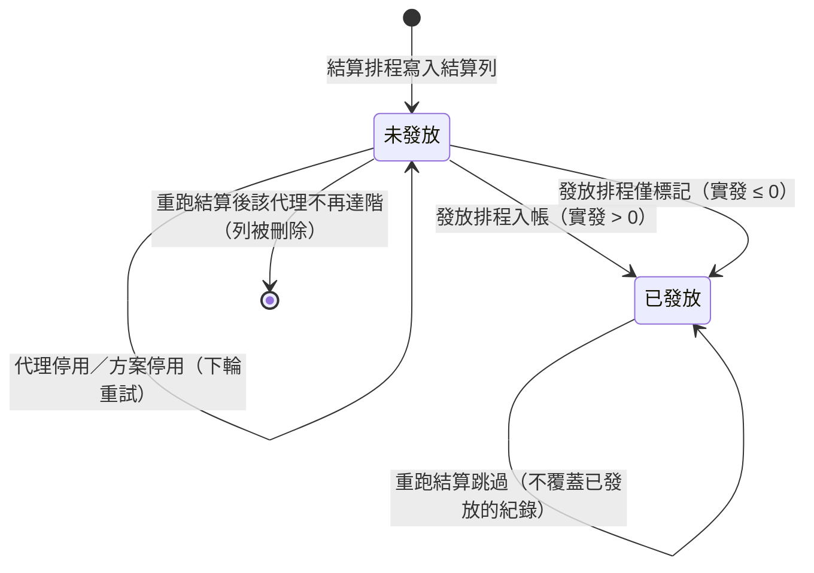

> ← [推廣代理 GGR 使用手冊](index.md)

# 2. 結算與發放

## 2.1 每天什麼時候跑

| 排程 | 時間 | 做什麼 |
|---|---|---|
| `ggr:settle` | 每日 **GMT+8 15:00** | 逐個啟用中方案算出昨天（含之前未結算）的結算列，狀態為未發放 |
| `ggr:payout` | 每日 **GMT+8 16:00** | 把未發放的結算列入帳到代理餘額，狀態改已發放 |

`routes/console.php` 裡寫的是 `dailyAt('07:00')` 與 `dailyAt('08:00')`，因為**排程判定走 UTC**（`config/app.php` 的 timezone 是 UTC），UTC 07:00 就是 GMT+8 15:00。要調整時間請記得寫 UTC 值。

同一份程式裡有兩套時間基準，別混用：**排程觸發用 UTC**，**結算區間用業務日（GMT+8）**。派發紀錄頁顯示的日期與時間都已換算成 GMT+8。

## 2.2 結算哪些期間

系統維護一個「已結算到哪一天」的游標（方案的 `settled_through`），每次執行從游標的次日往後推，推到「期末仍早於今天業務日」為止。**今天所在的那一期永遠不會被結算**，所以不需要關帳判斷。

游標取三者最晚：方案開始日期、`settled_through` 的次日、最新結算列 `period_end` 的次日。

正常每天都跑的情況下，**每次執行只結算前一天那一期**。會一次結算多期只有三種情況：排程漏跑（節點汰換、佇列堵塞、部署空窗）、手動補跑帶較晚的截至日、以及方案剛建立且開始日期早於今天。

單次最多推 400 期（防無限迴圈的保險絲），超過的留給下一輪。

**期間都沒有代理達階也會推進游標**——這是刻意的，否則一個沒人達標的日子會讓游標永遠卡住。

## 2.3 計算公式

以下是工單 2026-09-01 定案的版本。

```
判斷值 = 加權總和 − 獎金基數 × 獎金%

判斷值 > 0  →  X = 判斷值 × 條件設置應得百分比% × 代理設置GGR%
               管理費 = X × 管理費%
               代理實得 = X − 管理費 − 手續費

判斷值 ≤ 0  →  代理實得 = X（管理費與手續費都不扣，兩欄顯示 0）
```

- **加權總和**：直屬會員的逐筆注單，依遊戲商設置落階加權後的總和（見 [1-營運設定操作](1-營運設定操作.md#11-代理遊戲商設置)）。
- **獎金基數**：SR15 代理對帳報表的「彩金與活動」減「回收金額」，**以 0 為下限**（回收大於彩金時取 0，不會出現負的獎金費用）。
- **判斷值等於 0 時比照負數**：不扣管理費也不扣手續費。這一點很重要——若當成正數，固定手續費會讓「不賺不賠」的代理倒欠錢。

**兩個百分比是連乘的**，順序是先條件設置的應得百分比、再方案的 GGR%；管理費抽在兩者都乘完之後的金額上。

### 各項時間怎麼認列

工單定案「時間認列完全沿用 SR15 既有邏輯，不另訂規則」，所以各項的時間窗不是統一的：

| 項目 | 時間窗 |
|---|---|
| GGR（注單） | 業務日換算成的 UTC 區間 |
| 彩金與活動（點數、錢包點數、彩金、樂透） | 業務日換算成的 UTC 區間 |
| **回收金額** | **照 SR15 現況，直接用 GMT+8 的業務日邊界去比對 UTC 的建立時間，不減 8 小時** |

回收這一項的副作用要知道：每天 GMT+8 00:00–08:00 之間發生的回收會被算進**前一期**。若前一期的獎金基數已經被「以 0 為下限」截斷，那筆回收就不會再影響任何一期。

**這是刻意保留的**（2026-09-03 確認不改），好處是獎金與回收的數字可以直接拿 SR15 報表核對，QA 不用另建對帳方式。看到 8 小時的偏移不用當成缺陷追。

### 實際案例

以下是 dev 環境的真實資料（方案：條件 70%、GGR 30%、管理費 5%、獎金 50%）：

| 代理 | 加權總和 | 獎金基數 | 判斷值 | X | 管理費 | 手續費 | 代理實得 |
|---|---|---|---|---|---|---|---|
| BooBam | 14.61 | 0 | +14.61 | 3.0681 | 0.1534 | 200 | **−197.09** |
| BooBam（手續費改 0） | 14.61 | 0 | +14.61 | 3.0681 | 0.1534 | 0 | **2.91** |
| leodev | 0 | 0 | **0** | 0 | 不扣 | 不扣 | **0.00** |

第一列就是「固定手續費把小額正業績吃成負數」的實例；第三列是判斷值為 0 的邊界。

## 2.4 發揚（負數結轉）怎麼運作

結算算完「代理實得」之後，還要跟遞延餘額結算一次：

```
實發金額 = 代理實得 + 上期帶入的遞延餘額（遞延餘額是負數或 0）

實發金額 ≥ 0  →  實發這個金額，遞延餘額歸 0
實發金額 < 0  →  實發 0；發揚開＝整筆繼續累積，發揚關＝歸 0
```

規則細節：

- 遞延餘額**沒有上限也沒有期限**，不打銷。
- 代理停用或離場**呆帳續留**，恢復後餘額還在（停用的代理不產生新結算，餘額自然凍結）。
- 換綁條件設置或代理群組**不歸零**，餘額跟著代理走。
- 派發紀錄頁的「遞延餘額」欄就是這個值。

三期連續的例子（每天各跑一次結算，發揚開）：

| 期間 | 代理實得 | 帶入 | 實發 | 帶出 |
|---|---|---|---|---|
| 第一期 | −180.05 | 0 | 0 | −180.05 |
| 第二期 | 142.00 | −180.05 | 0 | −38.05 |
| 第三期 | 370.00 | −38.05 | **331.95** | 0 |

## 2.5 發放做什麼

發放排程只處理「**未發放** 且 **方案啟用中**」的結算列，逐列處理：

| 情況 | 結果 |
|---|---|
| 實發金額 > 0 | 加進代理餘額、寫一筆交易紀錄、狀態改已發放 |
| 實發金額 ≤ 0 | 只把狀態改已發放，不動餘額、不寫交易紀錄 |
| 代理停用或不存在 | **留在未發放**，下輪自動重試（代理恢復後就會補發） |
| 方案已停用 | **留在未發放**，不入帳 |
| 已經是已發放 | 跳過 |

入帳同時會在 `transaction_log_agents` 寫一筆帳變紀錄：

| 欄位 | 值 |
|---|---|
| 類型 | `11`＝GGR 分潤發放 |
| 付款方 | 方案的總代（僅表示歸屬，**總代餘額不會被扣**） |
| 收款方 | 被發放的代理 |
| 金額 | 實發金額 |
| 備註 | `ggr_settlement:{結算列 id} {期間起}~{期間迄}` |

代理可以在「現金錢包 > 交易紀錄」報表看到這筆，交易類型顯示「GGR分潤發放」。

> ⚠️ 舊代理後台的部分報表尚未把類型 11 納入既有的排除清單，「客服間開洗分」總額目前會把 GGR 分潤算進去；帳變通知也還沒含這個類型。這兩項要在 `API_Agent` 端補。

## 2.6 狀態流轉



## 2.7 手動補跑（Olympus）

平台端「系統操作」有兩個頁面，兩者都是**同步執行**，跑完才回結果，失敗會如實顯示在操作紀錄。

**GGR 推廣代理結算**

| 欄位 | 說明 |
|---|---|
| GGR 方案 | 留空＝全部啟用中方案 |
| 結算截至業務日（含，GMT+8） | 預設昨日。系統只結算期末早於「截至日 +1」的期間 |
| 乾跑模式 | 只試算不落庫，逐代理列出加權總和／判斷值／條件%／最終／實發／結轉 |

**GGR 推廣代理發放**

| 欄位 | 說明 |
|---|---|
| GGR 方案 | 留空＝全部未發放結算列 |
| 乾跑模式 | 只列出將發放清單與每列的處理方式，不入帳、不改狀態 |

驗收前建議都先跑乾跑看數字，確認後再關掉乾跑實跑。

## 2.8 重跑規則

- **同一期重跑會覆蓋未發放的紀錄**，並刪掉「本輪不再產生結果」的未發放列（代理不再達階、移出群組、綁定被停用）。
- **已發放的紀錄不會被覆蓋**，只記一筆警告。錢已經出去了，快照必須保持發放當下的狀態。
- **重跑中間某一期會讓後面幾期的遞延餘額失準**。要重算歷史，必須從最早的目標期開始，依序重跑它之後所有未發放的期。
- 結算列的寫入、游標推進、完成標記在**同一個資料庫交易**裡完成，所以「沒有紀錄」就代表「那期真的沒跑完」。
- 每期上鎖（方案 × 期間），同一期不會被兩個流程同時結算。
