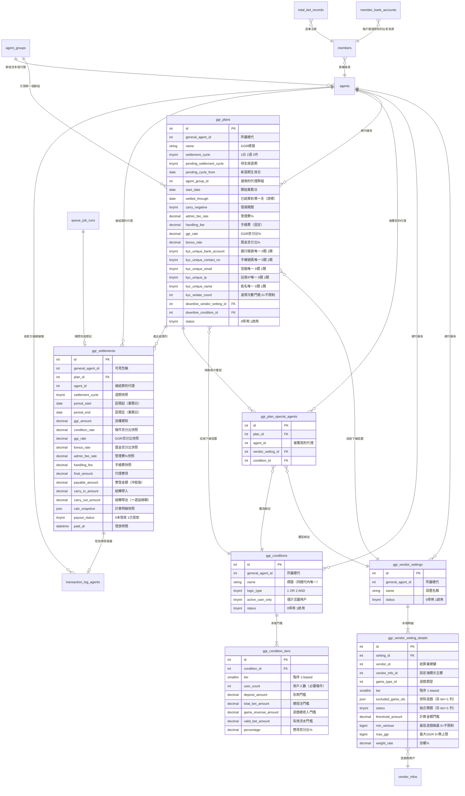

> ← [推廣代理 GGR 使用手冊](index.md)

# 3. 資料模型

七張 GGR 自有資料表，加上幾張既有表。所有外鍵都是**邏輯關聯**（欄位對應，沒有資料庫層的 FOREIGN KEY 約束）。

## 3.1 ER 圖

## 3.2 各表重點

### ggr_vendor_settings / ggr_vendor_setting_details

一組設置＝一個主表列＋多個明細列。明細的唯一鍵是 `(setting_id, vendor_info_id, game_type_id, tier)`，更新時**全量替換**。

- 結算時的彙總維度是 `vendor_id × game_type_id`（`vendor_info_id` 只是設定端顯示用），因為注單表只有 `vendor_id`。
- `excluded_game_ids` 與 `status` 是整個組合共用的，只存在 `tier = 1` 那一列。
- `min_winlose` 與 `max_ggr` 早期用 NULL 表示不限制，現已改為 **NOT NULL、0＝不限制**。

### ggr_conditions / ggr_condition_tiers

一組條件＝一個主表列＋多個階梯列，唯一鍵 `(condition_id, tier)`，更新時全量替換。主表另有 `(general_agent_id, name)` 唯一鍵，同一總代內標題不可重複。

各階的 `user_count` 與 `percentage` 必須逐階遞增。

### ggr_plans

方案主表。除了設定欄位，有三個由引擎維護的欄位：

| 欄位 | 誰在寫 | 用途 |
|---|---|---|
| `settled_through` | 結算引擎（與完成標記同交易） | 已結算到哪一個業務日，期間推導的游標 |
| `pending_settlement_cycle` | 設定端（改週期時） | 待生效的新週期 |
| `pending_cycle_from` | 設定端（改週期時） | 新週期從哪個業務日開始生效 |

改週期時不會動 `settlement_cycle`，而是寫 pending 兩欄；引擎推進到生效日才把它落地並清空。所以編輯畫面顯示的是「設定端視角」（有 pending 就顯示 pending）。

**帳戶驗證限制**用六個欄位：五個唯一限制開關（0 關、1 開），加上違規次數門檻 `kyc_violate_count`（0＝不限制）。結算時由 `MemberEligibilityFilter` 讀這六欄，把不合格的直屬會員先剔除。判定規則見 [營運設定操作](1-營運設定操作.md) 的「帳戶驗證限制」。各開關比對的資料：

| 開關 | 比對的資料 |
|---|---|
| `kyc_unique_bank_account` | `member_bank_accounts.account_no`，只看 `status=1` 的帳號；一位會員可能有多筆 |
| `kyc_unique_contact_no` | `members.mobile` |
| `kyc_unique_email` | `members.email` |
| `kyc_unique_ip` | `members.register_ip` |
| `kyc_unique_name` | `members.first_name` 與 `last_name` 以空白串接 |

### ggr_settlements

一列＝一個方案 × 一個代理 × 一個期間，唯一鍵 `(plan_id, agent_id, period_start)`。

**費率欄位都是快照**：方案日後改設定，歷史紀錄仍顯示當時的值。

`calc_snapshot` 存計算明細，是詳情彈窗與對帳的依據，內容包含各遊戲商的加權明細、獎金五項組成、判斷值、管理費、命中的階與合格會員數、結轉明細，以及會員篩選結果 `eligibility`（直屬會員總數 `direct_total`、被帳戶驗證限制剔除的人數 `kyc_excluded`）。

索引：`general_agent_id`、`agent_id`、`(payout_status, plan_id)`（發放查詢用）。

`bonus_amount` 是紅利金額的預留欄位，目前純手動、前端不顯示。

### 借用的既有表

| 資料表 | 用途 |
|---|---|
| `total_bet_records` | GGR 來源，逐筆注單，以 `payout_time`（UTC）認列 |
| `member_hourly_statistics` | 條件判定的存款門檻來源 |
| `summary_bet_records`、`summary_event_record_agents`、`transaction_logs`、`wallet_transaction_logs`、`event_v2_recycles` | 獎金與回收的來源（對齊 SR15 報表口徑） |
| `transaction_log_agents` | 發放時寫入的代理帳變紀錄，類型 `11` |
| `queue_job_runs` | 每期結算的完成標記，`job_key = ggr_settlement`、`work_key = 方案 id`、`bucket_time = 期間起日` |
| `agents`、`agent_groups`、`members`、`games`、`vendor_infos` | 代理階層、群組、直屬會員與遊戲對應 |
| `member_bank_accounts` | 帳戶驗證限制「銀行帳號唯一」的比對來源 |
