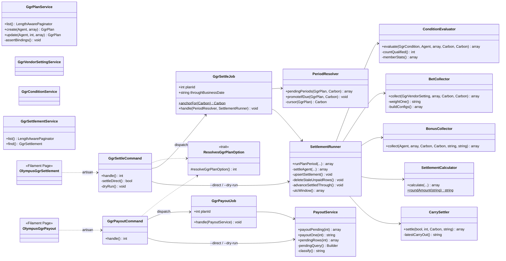
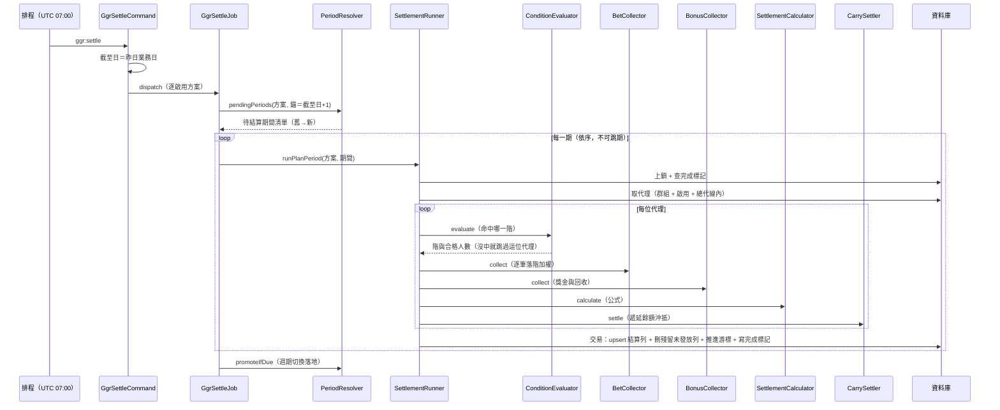

> ← [推廣代理 GGR 使用手冊](index.md)

# 4. 程式結構

分三塊：代理後台的設定 API、結算與發放引擎、平台端的手動補跑入口。

## 4.1 類別圖

## 4.2 各類別在做什麼

### 引擎

| 類別 | 職責 |
|---|---|
| `PeriodResolver` | 算出「還有哪些期間沒結算」，以及週期切換的落地時機 |
| `SettlementRunner` | 一期的主流程：上鎖、查完成標記、取代理、逐代理算、寫入交易 |
| `ConditionEvaluator` | 判斷代理命中哪一階，回傳該階與合格會員數 |
| `BetCollector` | 逐筆注單落階加權，算出加權總和與各遊戲商明細 |
| `BonusCollector` | 依 SR15 口徑歸集獎金五項組成並扣回收 |
| `SettlementCalculator` | 公式本身（判斷值、管理費、代理實得）與落庫金額的四捨五入 |
| `CarrySettler` | 遞延餘額的沖抵與帶出 |
| `PayoutService` | 發放：狀態守門、餘額入帳、寫帳變、標記已發放 |

### 觸發入口

| 類別 | 職責 |
|---|---|
| `GgrSettleCommand` / `GgrPayoutCommand` | artisan 觸發器。預設丟佇列；`--direct` 同步執行且失敗回非 0；`--dry-run` 唯讀試算 |
| `ResolvesGgrPlanOption`（trait） | 兩個命令共用的 `--plan` 驗證（必須是存在的正整數方案 id） |
| `GgrSettleJob` | 一顆 job 一個方案，依序 catch-up 所有待結算期間，最後落地週期切換 |
| `GgrPayoutJob` | 全域單飛，把未發放列逐列入帳 |
| Olympus 兩個 Filament 頁 | 手動補跑，帶 `--direct` 或 `--dry-run` 呼叫上面的命令 |

### 設定 API

| 類別 | 職責 |
|---|---|
| `GgrVendorSettingService` | 4123 遊戲商設置 CRUD、遊戲商與遊戲清單來源、階梯驗證 |
| `GgrConditionService` | 4124 條件設置 CRUD、階梯遞增與標題唯一驗證 |
| `GgrPlanService` | 4121 方案 CRUD、綁定歸屬複驗、同群組單一啟用方案、週期切換寫 pending |
| `GgrSettlementService` | 4125 派發紀錄查詢（清單與詳情），以總代隔離 |

## 4.3 一期結算的呼叫鏈

## 4.4 併發與重試的保護

| 機制 | 位置 | 擋什麼 |
|---|---|---|
| `WithoutOverlapping`（方案層） | `GgrSettleJob` | 同一方案不會有兩顆 job 同時跑 |
| `WithoutOverlapping`（全域） | `GgrPayoutJob` | 發放全域單飛，避免同代理多列搶餘額鎖 |
| 分散鎖（方案 × 期間） | `SettlementRunner` | 同一期不會被排程與手動補跑同時結算 |
| 完成標記（`queue_job_runs`） | `SettlementRunner` | 已完成的期直接跳過；與資料寫入同交易，所以「缺列＝缺資料」 |
| 鎖來源單＋查狀態 | `PayoutService` | 發放冪等的唯一防線。交易紀錄表沒有唯一鍵，順序不可對調 |
| 已發放不覆蓋 | `SettlementRunner` | 重跑不會洗掉已經發出去的錢 |

兩顆 job 都走 `redis-long-running` 佇列（`retry_after` 3660 秒 > `timeout` 600 秒），`tries` 不設上限、`maxExceptions` 3；最終失敗會落 `failed_jobs` 並發 BotNotify，缺漏的期間由隔日排程自動接手。

> ⚠️ 這條佇列在 prod 只有 2 個 worker、dev 只有 1 個，SBR 整點彙總、遊戲清單同步、拉注單也共用它。16:00 的發放只保證「派發時間」，不保證「執行時間」。
