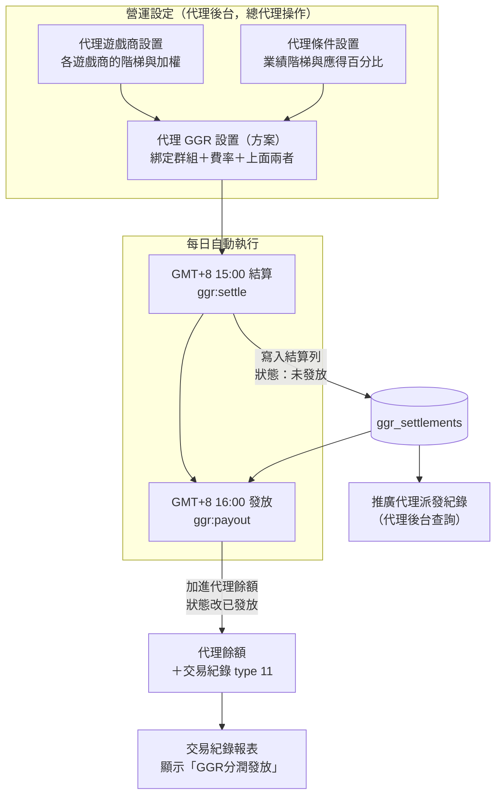

# 推廣代理 GGR 使用手冊

最新版本：**v1.0.1**（2026-09-03）— 補回收金額的時間認列說明與時區段改寫。詳見 [CHANGELOG](CHANGELOG.md)。

## 這套功能在做什麼

總代理可以設定一套規則，讓旗下代理依「會員在遊戲裡輸給公司的錢」按比例分潤，系統每天自動算帳、隔一小時把錢加進代理餘額。

一句話流程：**代理的直屬會員下注 → 系統每天算出該代理分到多少 → 隔一小時入帳到代理餘額 → 代理在後台看得到明細**。

工單來源：`target/tickets#4121`（方案設定與計算公式）、`#4123`（遊戲商設置）、`#4124`（條件設置）、`#4125`（派發紀錄）。

## 名詞說明

第一次接觸這塊時，以下幾個詞最容易混淆，先固定意思：

| 名詞 | 意思 |
|---|---|
| **GGR** | Gross Gaming Revenue，公司從會員身上賺到的錢。單筆注單的 GGR ＝ 會員輸贏的相反數（會員輸 100，GGR 就是 +100） |
| **總代理（總代）** | `role_id = 11` 的代理。GGR 的三張設定表都以總代為單位，各總代看不到彼此的設定 |
| **直屬下線會員** | 直接掛在某個代理底下的會員，**不含下級代理的會員**，也不往下遞迴 |
| **代理群組** | 個性化組別（`agent_groups`，型別為個性化設置）。方案透過群組決定「這套規則適用哪些代理」 |
| **加權總和** | 每筆注單的 GGR 依遊戲商設置落階、乘上加權%之後的總和。公式的起點 |
| **判斷值** | 加權總和扣掉獎金費用之後的金額。它決定要不要扣管理費與手續費 |
| **有效分潤率** | 條件設置的應得百分比 × 代理設置 GGR%。兩個百分比是連乘的，50% 配 30% 只剩 15% |
| **發揚（負數結轉）** | 方案開關。開啟時當期算出的負數會累積到下期，下期算出正數要先沖抵完才發放 |
| **遞延餘額** | 目前累積的負數餘額（結算列的「結轉帶出」）。跟著代理走，換綁設定不歸零 |
| **業務日** | 以 GMT+8 計算的日期。所有結算區間都以業務日切分，與系統時間（UTC）不同 |

## 誰能使用

**代理後台**（新後台）— 需要下列選單權限，由上級或平台端開通：

| 選單 id | 名稱 | 用途 |
|---|---|---|
| 410 | 推廣代理 | 父節點 |
| 411 | 代理遊戲商設置 | 設定各遊戲商的階梯與加權 |
| 412 | 代理條件設置 | 設定業績階梯與應得百分比 |
| 413 | 代理 GGR 設置 | 建立方案，把上面兩者綁起來 |
| 414 | 推廣代理派發紀錄 | 查結算與發放結果 |

只有總代理身分能管理這些設定；一般代理開了權限也會被擋（回「僅總代可管理此設置」）。

**Olympus（平台端後台）**— 「系統操作」群組下有兩個手動補跑頁，供工程與維運使用：

- GGR 推廣代理結算
- GGR 推廣代理發放

## 整體流程

## 章節導覽

| 章節 | 內容 | 讀者 |
|---|---|---|
| [1-營運設定操作](1-營運設定操作.md) | 三個設定頁怎麼填、特殊用戶怎麼用、哪些設定會踩雷 | 營運、QA |
| [2-結算與發放](2-結算與發放.md) | 排程時間、期間怎麼切、公式與案例、狀態流轉、手動補跑 | 營運、QA、工程 |
| [3-資料模型](3-資料模型.md) | ER 圖與各資料表欄位 | 工程 |
| [4-程式結構](4-程式結構.md) | 類別圖、各類別職責、呼叫鏈 | 工程 |
| [故障排除](故障排除.md) | 症狀 → 原因 → 處理 | 全部 |
