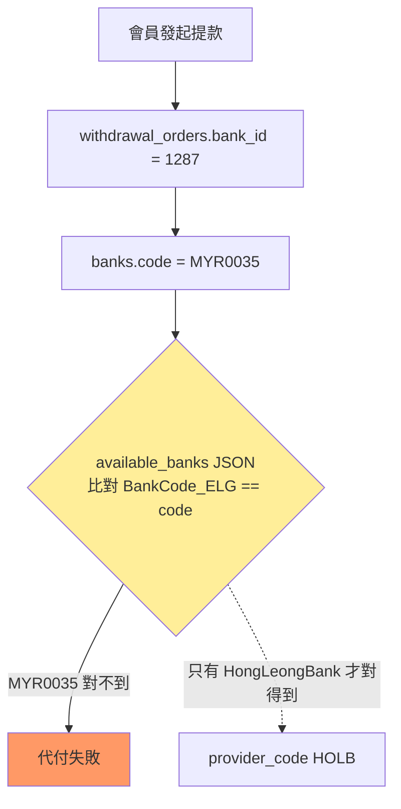
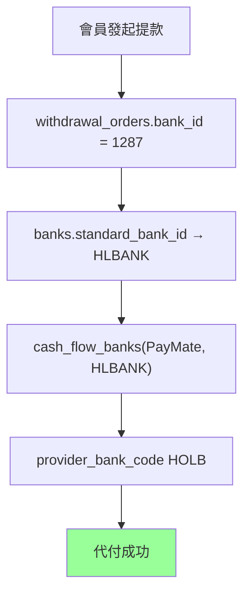

# 方案 B｜清洗＋代付查表化 ⭐ 推薦

> **層級**：銀行收斂五級方案的第 2 級，完整承接 [方案 A](./方案A-資料清洗止血.md)。分級總覽與決策狀態見 [RB/TODO.md §3.1.3](../../RB/TODO.md)。
> **工程量**：16–19 人天（含 A）｜**曆時**：約 4 週
> **定位**：A 全部 ＋ 把代付對映從「店內碼字串比對」換成「外鍵查表」，order-155 **類**問題根治。

---

## 1. 現況死因：字串比對

代付對映（`app/Services/Payment/Traits/WithdrawalPayoutTrait.php` `convertPayoutBankCode()`）從 `agent_cash_flows.info['available_banks']` JSON 逐筆比對 `BankCode_ELG == banks.code`，對到回 `BankCode_Third`，**對不到回空字串**——鍵是店內碼，碼一亂就對不到：



## 2. 目標：走外鍵，與店內碼無關



對映鏈（鍵從「字串比對」換成「外鍵」）：

```
withdrawal_order.bank_id
  → banks.standard_bank_id                                   (白標開放層映射)
  → cash_flow_banks(cash_flow_id, standard_bank_id).provider_bank_code
```

order 155 根治：`1287 → HLBANK → cash_flow_banks(PayMate, HLBANK) → HOLB`，與店內碼 `MYR0035` 徹底無關。

## 3. 工作項（承接 A1–A4）

| # | 增量工作項 | 性質 | 人天 |
|---|---|---|---|
| B1 | 盤點並補齊 `cash_flow_banks` 寫入覆蓋面。**⚠️ 校正（2026-07-06 讀碼）**：`cash_flow_banks` 表**已有寫入路徑**——`SyncCashFlowsCommand` 的 `createCashFlowBankRelation()`（`app/Console/Commands/CashFlow/SyncCashFlowsCommand.php:2160,2226`）已在 sync 時建立 `(cash_flow_id, standard_bank_id, provider_bank_code)`，另有 `Patch/CheckCashFlowBanksIntegrity` 維護命令。B1 因此不是「從零新寫」，而是**確認 sync 產出的 `cash_flow_banks` 是否涵蓋代付所需的所有 `(cash_flow_id, standard_bank)` 對**，補齊缺漏（尤其純代收 provider 未進 sync 的情形），工時下修。 | 盤點＋補寫 | 1–2 |
| B2 | 代付 `convertPayoutBankCode` 改查 `cash_flow_banks`＋fallback JSON＋feature flag 逐 provider 灰度 | 改寫 | 4 |
| B3 | 端到端驗收（order 155 類對映成功、新舊路徑一致性比對） | 驗收 | 1–2 |

> **驗證註（2026-07-06）**：主張「代付走 `available_banks` 字串比對」屬實（`WithdrawalPayoutTrait.php:152–163`，`==` 鬆比對、對不到回空字串，至少 19 個 provider 呼叫）。但 `available_banks` 是 `agent_cash_flows.info` 的 **TEXT 欄位**（Eloquent cast array），非 MySQL 原生 JSON 型別——遷移期無 DB 層約束，雙寫灰度成本要據此估。

## 4. 過渡相容

代付邏輯加分支——有 `cash_flow_banks` 資料走新路徑、否則 fallback `available_banks` JSON；feature flag 逐 provider 灰度，新舊一致性比對通過後才拆 JSON（拆除屬 [方案 D](./方案D-完整四層收斂.md) 的 C8）。回滾＝關 flag 回 JSON 路徑。

## 5. 優缺點與適用

- **優點**：對映與店內碼徹底脫鉤，「建錯碼／provider 改碼／跨碼再冒」不再炸代付；工程量可控（~4 週）；所有產出直接沿用進 C/D。
- **缺點**：canonical 只覆蓋營運中幣別（15 個幣別中仍有多個無 canonical）；資料仍手工維護、不可重生；同碼異義只處理清洗中撞到的個案。
- **適用**：要在一個月內根治代付失敗、又保留升級路徑——**性價比最高的停靠站**。
