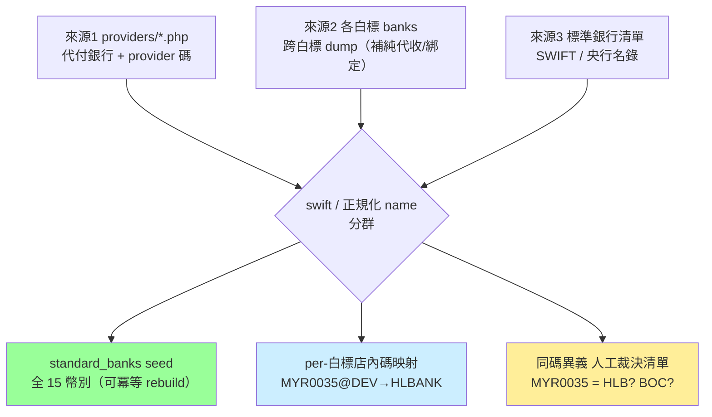

# 方案 C｜canonical 完整性核心（B＋C-core）

> **層級**：銀行收斂五級方案的第 3 級，完整承接 [方案 B](./方案B-代付查表化.md)；**僅在確定要走 [方案 E（跨專案中台）](./方案E-跨專案MDM中台.md) 時選**，否則直上 [方案 D](./方案D-完整四層收斂.md) 或停在 B。分級總覽與決策狀態見 [RB/TODO.md §3.1.3](../../RB/TODO.md)。
> **工程量**：32–38 人天（B 16–19 ＋ C-core 16–19）｜**曆時**：約 8–9 週
> **定位**：把方案 D 拆成「E 的硬前提（C-core，本案納入）」與「可延後收尾（C-tail，延後不取消）」兩半，讓 E 能及早啟動。

---

## 1. C-core 與 C-tail 的切分

| 部分 | 內容 | 人天 | 對 E（中台）的必要性 |
|---|---|---|---|
| **C-core（本案納入）** | C1 三來源聯集全幣別 seed、C2 裁決機制、C3 per-白標映射、C4 rebuild、C5 逐白標回填 | 16–19 | ✅ 缺一不可——canonical 完整性、同碼異義解析、對映率三者是 MDM 可信度的底線 |
| **C-tail（延後）** | C6 member 外鍵全面收斂、C7 全白標灰度、C8 拆 available_banks JSON | 11–13 | ⚠️ 不擋 E 啟動，但 C7 至少要覆蓋「要加入中台的白標」 |

> **注意**：C-tail 是延後不是取消——尤其 C8（拆 JSON）拖越久，新舊雙路徑並行的維護成本越高，應設明確期限。E 本身依賴尚未存在的中台基建：等基建的時間窗通常足夠把 C-tail 做完，屆時 C 與 D 殊途同歸。

## 2. L1 Canonical 主檔設計

### 2.1 穩定 key 策略

| 銀行型態 | key | 理由 |
|---|---|---|
| 一般銀行 | `(currency_id, swift)` | swift 是國際穩定 identity，name 會變動 |
| eWallet / QR（Touch N Go、GX Bank、Boost、DuitNow…） | `(currency_id, canonical_code)` | 這類**沒有 swift** |

→ `bank_type` 分 `BANK / EWALLET / QR`，否則無 swift 的 eWallet 無法唯一化。

### 2.2 ⚠️ Schema evolution（C 級起手的前置 migration）

現行 `standard_banks`（migration `2026_05_14_000001_create_standard_banks_and_bank_mapping.php`）有 `code` / `name` / `bank_type`（tinyint，含 comment 1=銀行 2=電子錢包）/ `sort` / `image_url` / `deleted_at`，unique 為 `(currency_id, code)` 與 `(currency_id, name)`——**缺 `swift` 與 `aliases`**。C 級動工前需先出 migration：

> **⚠️ 校正（2026-07-06 讀碼）**：原文誤稱「沒有 `swift`、`bank_type`、`aliases`」；實測 **`bank_type` 已存在於 migration**，缺口只有 `swift` 與 `aliases` 兩欄。

- 新增 `swift`（nullable，eWallet 為 null）、aliases 儲存（JSON 欄位或子表擇一）
- unique constraint 演進為「swift 有值用 `(currency_id, swift)`、否則用 `(currency_id, code)`」的可執行形式

### 2.3 seed 檔結構（沿用 `Data/providers/*.php` 慣例）

```php
[
  'code'      => 'HLBANK',            // canonical 內部碼，全平台唯一、穩定
  'name'      => 'Hong Leong Bank',
  'swift'     => 'HLBBMYKL',          // eWallet 為 null
  'bank_type' => BankType::BANK,
  'sort'      => 5,
  'aliases'   => ['HLB', 'Hong Leong Bank', 'HongLeong'],  // 只收無歧義變體
]
```

rebuild 冪等：upsert by key（swift 有值用 swift、否則用 code），aliases 每次以 seed 覆寫。

### 2.4 深水區：全域 aliases 不能無條件收店內碼

`MYR0035` 在 DEV=Hong Leong、TPower=Bank of China。若收進 `HLBANK` 全域 aliases，TPower 遷移會把 Bank of China 錯對到 Hong Leong → **跨白標資損級錯誤**。aliases 分兩級：

| 類型 | 例 | 去處 |
|---|---|---|
| **全域無歧義**（swift、明確名稱、國際通用碼） | `HLBBMYKL`、`Hong Leong Bank`、`HLB` | ✅ 進 `standard_banks.aliases` |
| **白標店內自造碼**（同碼跨白標可能異義） | `MYR0035`、`TPMY02`、`WTMY03` | ❌ 進 **per-白標遷移映射**，用完即棄 |

店內碼各白標**一次性**在自己 DB 內解析 `(白標, 店內code) → standard_bank_id`，語意不跨站污染，可用 `bank_dedup_logs` 類審計表承載。

### 2.5 三來源聯集

| 來源 | 貢獻 | 餵給 |
|---|---|---|
| 1. `Data/providers/*.php` | 代付支援銀行＋provider 碼 | L1＋cash_flow_banks |
| 2. 各白標現有 banks（跨白標 dump 歸群） | 補純代收/綁定銀行、歷史碼變體 | L1 aliases＋per-白標映射 |
| 3. 標準銀行清單（SWIFT/央行名錄 per currency） | 權威 canonical name/swift/type | L1 |



> canonical 可重生，但 aliases 初始蒐集是一次性工程（跨白標 dump→歸群→人工裁決），之後固化進 seed。

## 3. 工作項（承接 B，C-core）

| # | 增量工作項 | 人天 |
|---|---|---|
| C1 | 三來源聯集萃取器 → 全 15 幣別 seed＋per-白標映射＋裁決清單（含 §2.2 schema evolution migration） | 6–8 |
| C2 | 同碼異義人工裁決佇列機制（工程 2 天；業務裁決另計曆時 3–5 天） | 2 |
| C3 | per-白標店內碼映射解析層（一次性、審計表承載） | 3 |
| C4 | rebuild `standard_banks` 全 15 幣別（宣告式 seed upsert 已由 `cash-flow:seed-standard-banks` 實現，本項僅需把 config 擴至 15 幣別；舊 `cash-flow:backfill-standard-banks` 已於 2026-07-28 移除） | 2 |
| C5 | 回填 `standard_bank_id` 逐白標（swift → 全域 alias → per-白標映射，對不到落 audit；回填命令**需新寫**） | 3–4 |

**現況基線**（DEV，status=1）：`banks` 涵蓋 15 個幣別、`standard_bank_id` 全部 mapped=0（對齊機制空跑）；`standard_banks` 只有 5 個幣別（MYR 31 / SGD 24 / VND 43 / IDR 108 / BDT 3）。C5 驗收＝`mapped = active banks 數`、audit 清空。

## 4. 優缺點與適用

- **優點**：E 的三個硬前提（canonical 完整性、同碼異義解析、對映率）全數到位，E 可及早啟動。
- **缺點**：C-tail 延後造成新舊雙路徑並行期拉長；業務側需投入同碼異義裁決。
- **適用**：**僅在確定要走 E 時選**。純粹想要完整收斂（不做中台）直接評估 [方案 D](./方案D-完整四層收斂.md)。
