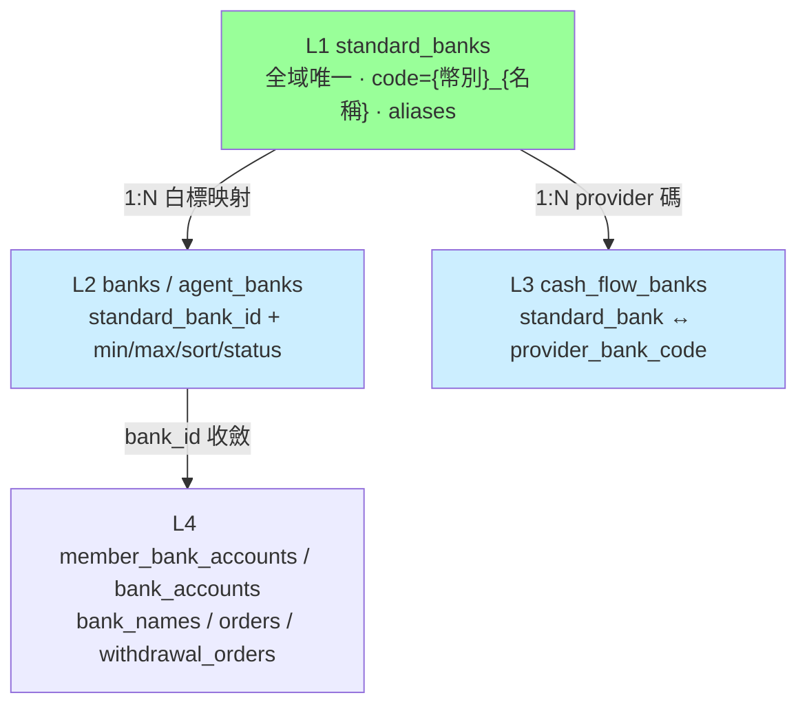
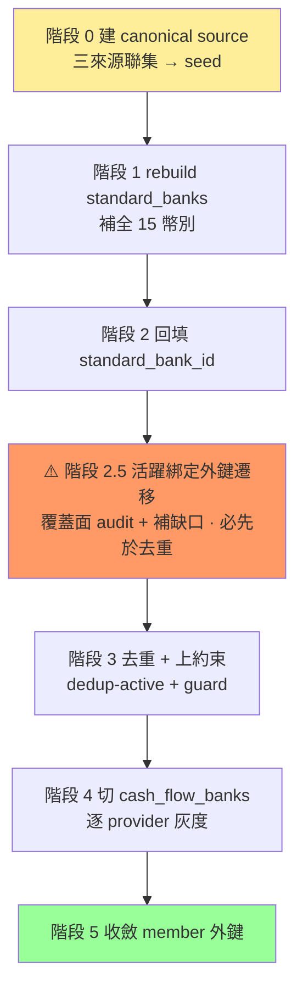

# 方案 D｜完整四層收斂

> **層級**：銀行收斂五級方案的第 4 級 ＝ [方案 B](./方案B-代付查表化.md) ＋ C1–C8 全部（[方案 C](./方案C-canonical完整性核心.md) 的 C-core 與 C-tail 一次做完）。分級總覽與決策狀態見 [RB/TODO.md §3.1.3](../../RB/TODO.md)。
> **工程量**：~~42–52 人天（含 B）~~ 2026-09-22 重算剩餘工作（含 25% 預留）：一人 45–55 人天、兩人 50–60 人天；拆解見 RB/TODO.md「D 的剩餘工作重算」｜**曆時**：~~約 10–12 週~~ 一人 12–14 週、兩人 8–10 週
> **定位**：建立宣告式權威來源與冪等 rebuild pipeline，讓「任何白標任何時候都能重新生成乾淨 banks」。資料是產物、可丟可重建；要重構的是產生資料的機制。

> **🔴 2026-07-06 重大修訂（4-agent 讀碼＋git 溯源後）**：本方案「從零建四層」的前提已部分翻案——master 其實**已落地 L3（`cash_flow_banks`，1727 列）、半落地 L2（`agent_banks` 死表）**，且**完全無 `standard_banks` migration**（DEV 209 列富 schema 是孤兒，不在任何 git ref、無代碼使用）。七階段因此需重排（**P3 複用 master、P5 延後、P4 提前**）、L1 對齊 **config** 而非孤兒表。本方案其餘敘述保留為**完整目標態**參考；本輪實際落點見 **[§4.1 共識調整](#41-2026-07-06-共識調整對照-master-既有資產優先於-4-線性表)**。

> **✅ 2026-08-12 第一期設計拍板**：本方案的起手式（絞殺者投影最小閉環：改造 `agent_banks` 死表＋cfb 加 `standard_bank_id` 便利欄＋冪等投影命令，不切讀取）已收斂落檔並於 2026-08 合入 master（migration `2026_08_13_000001_rebuild_agent_banks_and_add_cfb_standard_bank_id` 與 `BankProjectionService`）；設計文件已依落實即刪除原則移除，後續期順序寫在 `BankProjectionService` 的 class docblock。

---

## 1. 目標架構（四層，職責單一）

| 層 | 表 | 職責 | 多白標角色 |
|---|---|---|---|
| **L1 Canonical 主檔** | `standard_banks` | 一實體銀行一列，鍵是自訂語意碼 `code`＝`{幣別}_{名稱}`（例 `MYR_MAYBANK`，變體 `MYR_MAYBANK_CORP`），唯一性範圍 `(code, currency_id)`；`swift` 只是資訊欄位、可空可重複、不當鍵；`aliases` 吸收無歧義歷史碼變體 | 全域唯一、**無 agent_group 維度** |
| **L2 白標開放層** | `banks` / `agent_banks` | 只存 `standard_bank_id`＋min/max/sort/image/status | 白標差異全在這 |
| **L3 Provider 碼映射** | `cash_flow_banks` | `standard_bank ↔ provider_bank_code` | 取代 `available_banks` JSON |
| **L4 綁定外鍵** | `member_bank_accounts` / `bank_accounts` / `bank_names` / `orders` / `withdrawal_orders` / `bank_order_types` | `bank_id` 收斂到 canonical | 遷移用 `standard_bank_id` 兜底 |

**核心洞察**：`standard_banks` 不需要白標維度；多白標靠 L2/L3 映射表達，主檔保持全域唯一。`banks` 表**保留瘦身**為 L2（不退役 DROP——38.8 萬筆 `withdrawal_orders` 引用，退役風險過大）。

## 2. L2 白標開放層

- **瘦身**：`banks` 只留 `standard_bank_id`＋白標業務欄位（min/max/sort/image/status），不再自造 code/name。
- **去重合併鍵** = `(agent_group_id, currency_id, standard_bank_id)`：同組多列合併為一，保留啟用列、聚合額度、`old_bank_id → kept_bank_id` 記入映射。

> **⚠️ 前置決策：`agent_banks` 是死表（2026-07-06 讀碼）**
> migration `2026_03_16_000001` 建了 `agent_banks`（`agent_group_id + bank_id + cash_flow_id + min/max_amount`），但**全 codebase 零讀寫、無 Model 類別**。本方案把 `agent_banks` 列為 L2 之一，須先決定：**（a）啟用它**（補 Model／寫入／讀取路徑，成本進本方案）或 **（b）廢棄它**（DROP，L2 只留瘦身後的 `banks`）。在做出決定前，不可對 `agent_banks.bank_id` 假設任何外鍵語意——這也是 [方案 A](./方案A-資料清洗止血.md) A2 dedup 覆蓋面盤點的一環。避免「為一張沒有使用者的表設計遷移」的過度投入。
>
> **✅ 已裁決（2026-08-12）：採（a）啟用＋schema 改造**——migration 拿掉 `cash_flow_id`（渠道歸 L3 `cash_flow_banks`）、換 `standard_bank_id` 主錨＋`source_bank_id` 對照欄，定位純代理層。設計文件已依落實即刪除原則移除，實作見 migration `2026_08_13_000001_rebuild_agent_banks_and_add_cfb_standard_bank_id`。
- **可重生**：白標開放清單 seed → 冪等 rebuild；初始清單從各白標現況歸群萃取＋人工確認後固化。

## 3. L4 綁定外鍵收斂

| 類型 | 處置 |
|---|---|
| 活躍綁定（`member_bank_accounts`、`bank_accounts`） | 改指 `kept_bank_id` |
| 多語系（`bank_names`） | 併到 kept、去重語言 |
| **歷史訂單**（`orders`、`withdrawal_orders`） | **不改 bank_id**（訂單已冗餘存 snapshot），舊 banks 列**軟刪不物理刪**供歷史 join |

全程 transaction、逐白標、映射落 `bank_dedup_logs` 可回滾。

## 4. 七階段遷移（每步含驗收／回滾／灰度）

> 原規劃稱「五階段」，實際含階段 0 與 2.5 共**七步**，本文正名。
> **⚠️ 本表為完整目標態的線性鏈；本輪實際執行的重排（P3 複用/P5 延後/P4 提前）與 master 既有資產對照見 [§4.1](#41-2026-07-06-共識調整對照-master-既有資產優先於-4-線性表)。**
> **階段 2.5 的範圍**：僅遷移**活躍綁定**的 `bank_id` 外鍵（`member_bank_accounts`、`bank_accounts`、`bank_names`、`bank_order_types` 等）；歷史訂單（`orders`、`withdrawal_orders`）依 §3 不改，不在 2.5 範圍。

| 階段 | 動作 | 驗收 | 回滾 |
|---|---|---|---|
| **0 建 canonical source**（離線） | 三來源聯集→seed＋映射＋裁決清單；人工裁決同碼異義 | seed 涵蓋所有白標所有幣別出現過的實體銀行；裁決清單清空 | 純離線產物，無風險 |
| **1 rebuild standard_banks** | 吃新 seed 冪等 upsert，補全 15 幣別（含 schema evolution，見方案 C §2.2） | 全幣別齊、無重複 canonical、aliases 完整 | 重跑 seed |
| **2 回填 standard_bank_id**（逐白標） | 名稱關鍵字／alias 匹配 → per-白標映射；對不到落 audit | `mapped = active banks 數`（DEV 現 0）；audit 清空 | 欄位可重置重跑 |
| **⚠️ 2.5 活躍綁定外鍵遷移**（逐白標） | audit `bank:dedup-active` 現有 FK 遷移覆蓋面（已含 `member_bank_accounts` / `withdrawal_orders`）＋補齊缺漏引用表 | 無懸空引用 | 映射反向 |
| **3 去重＋上約束**（逐白標） | `bank:dedup-active` 合併、映射落 log；`bank:guard-active-banks` 上唯一約束 | 每組至多一 active | `bank:dedup-rollback` |
| **4 切 cash_flow_banks**（逐 provider 灰度） | 建表 from providers；代付走 std_bank_id，flag 逐 provider | order 155 類對映成功；新舊一致後拆 JSON | 關 flag 回 JSON |
| **5 收斂 member 外鍵** | 活躍綁定改指 kept；歷史訂單不動 | 無懸空 bank_id | 映射反向＋軟刪還原 |

**貫穿原則**：每階段 dry-run 先行、寫入包 transaction、映射落審計表、逐白標灰度、舊資料軟刪可回滾。

## 4.1 2026-07-06 共識調整：對照 master 既有資產（優先於 §4 線性表）

> git 溯源＋讀碼發現：RB 早期的「拆過載 `banks` 成三表」設計**已落地兩張半**，四層並非從零建。§4 的線性七階段（P0→…→P5）需按下述重排；上表保留為完整目標態，本段為**本輪實際執行基準**。

### 三表拆分 × master 現況

| 四層 / 三表 | master 現況 | 缺口 |
|---|---|---|
| **L1 `standard_banks`**（① 標準銀行表） | 🔴 **未落地**：無 migration；DEV 209 列富 schema 是孤兒（無 git ref、零代碼使用）；`Bank`/`CashFlowBank` model 只有 `standard_bank_id`/`code` 的 PHPDoc、無 relationship；指向的 `bank:sync-mappings` 命令不存在 | 建表＋回填＋映射命令 |
| **L3 `cash_flow_banks`**（② 金流商支援中間表） | 🟡 **半落地**：表已在 master（1727 列）、**代收在用**；**代付仍走 `available_banks` JSON**（`AddAgentCashFlow.php` type=3 建 JSON）＝order-155 死點 | 代付切換＋補 `standard_bank_code` 欄 migration |
| **L2 `agent_banks`**（③ 代理商配置中間表） | 🟡 **死表**：master 2026_03_16 已建、shape 對（group+bank+cashflow+min/max+status），但零讀寫、`bank_id` 仍指 `banks.id` | 本輪不接線（見下） |
| **canonical 真相** | ＝ **config** `Data/banks/StandardBankCodes.php`（code/name/currency/**aliases/keywords/third_party_codes**，**無 swift 欄**）；`StandardBankNameHelper` 讀 config 非讀表 | swift 是 DEV 額外 curation、不在 config |

> **§1 L1 的鍵已定案（2026-08-28 拍板、09-02 上生產）**：`standard_banks.code` 一律 `{幣別}_{名稱}` 自訂語意碼，六站 367 筆全帶幣別前綴；來源是 `app/Console/Commands/CashFlow/Data/banks/{MYR,VND,IDR,SGD,INR}.php` 五個分檔。曾考慮過「以 swift 為鍵」，因為 swift 會重複（DBS／POSB 共用）、會空（六成七條目查不到）、會退役，已作廢；`swift` 欄保留為純資訊。匹配走名稱關鍵字與 alias。

### 七階段重排（本輪基準）

| 階段 | 對 §4 的調整 | 說明 |
|---|---|---|
| **P0 建 canonical source** | 🟡 **簡化** | canonical＝config；P0 降為「以 config 為主 seed、swift 額外補」，DEV 孤兒僅參考，裁決工作大減 |
| **P1 rebuild standard_banks** | 🔴 **改寫（非事後 evolution）** | 直接把 phase-0 `2026_05_14` migration **改寫成 config 對齊富 schema、一次到位**（swift/aliases/keywords/third_party_codes）；須處理「DEV 已有孤兒表、不能 create 撞表」。**config 現僅 5 幣別，「補全 15 幣別」＝先擴 config**（真工作） |
| **P2 回填 standard_bank_id** | 🟡 **仍缺口** | 逐白標回填命令 `bank:sync-mappings` **master 不存在**，需新建 |
| **P2.5 活躍綁定外鍵遷移** | 🟢 **縮小** | master `BankActiveDedupService` 已 re-point `member_bank_accounts`/`withdrawal_orders`；audit 對象縮到「dedup 沒覆蓋的表」 |
| **P3 去重＋上約束** | 🟢 **幾乎歸零（複用）** | master 三件套（`bank:dedup-active`/`guard-active-banks`/`dedup-rollback`＋`bank_dedup_logs`）已完整；②③雙採不強制重指 → dedup key `(agent_group_id, type, currency_id, code)` **維持現狀零改動**、直接複用 |
| **P4 切 cash_flow_banks** | 🔺 **提前＋縮小** | 解 order-155 的關鍵、**不依賴 P3**，拉進**首增量**；表已在 master、代收已寫入，範圍縮到「代付切換＋補 `standard_bank_code` 欄」 |
| **P5 收斂 member 外鍵** | ⏸️ **本輪延後** | ②③暫雙採 `bank_id`＋`standard_bank_id`、不強制重指；全面 `standard_bank_id` 收斂＝完整 D，延後 |

### 相依鏈斷開（原 P0→…→P5 線性鏈拆成兩軌）

- **主軌（首增量）**：P1 改寫 → P2 回填 → **P4 代付切表**（解 order-155）
- **複用軌**：P3 直接用 master 既有工具；P2.5 縮小；P5 延後

### 新增前置項（原七階段沒有）

- **phase-0 lean migration `2026_05_14_000001` 退場**：不只在本分支、**也在 develop（f9df5f16a）**，捨棄須同時處理 develop（受 develop⊇master 不變式與禁 cherry-pick/force 約束，**先規劃再動手**）。

### 本輪落點

**≈ 方案 B（代付查表化）＋ ① `standard_banks` 地基正規化**，非完整 D。②③雙採、不強制重指；全面重指（D）留未來增量。

## 5. 工作項（承接 B，約 26–33 人天）

| # | 增量工作項 | 人天 |
|---|---|---|
| C1–C5 | C-core（三來源聯集、裁決機制、per-白標映射、rebuild、逐白標回填）——細節見 [方案 C](./方案C-canonical完整性核心.md) §3 | 16–19 |
| C6 | member 活躍綁定外鍵全面收斂（歷史訂單 bank_id 不動，snapshot 已凍結） | 3 |
| C7 | 全白標（8–9 個環境）逐站灰度部署＋驗收 | 4–5 |
| C8 | `available_banks` JSON 正式拆除＋測試補強＋回滾演練＋文件 | 4–5 |

## 6. 優缺點與適用

- **優點**：跨白標銀行身份統一（對帳 mapping 成本消失）；資料是產物、可丟可重建；新白標開站直接吃 seed；新金流商接入只填 `cash_flow_banks` 映射。
- **缺點**：曆時長（~10–12 週）；需業務側配合同碼異義裁決；全白標 rollout 需排程協調。
- **適用**：近期 roadmap 有新白標開站或金流商密集接入——機制的回收期會很短。
