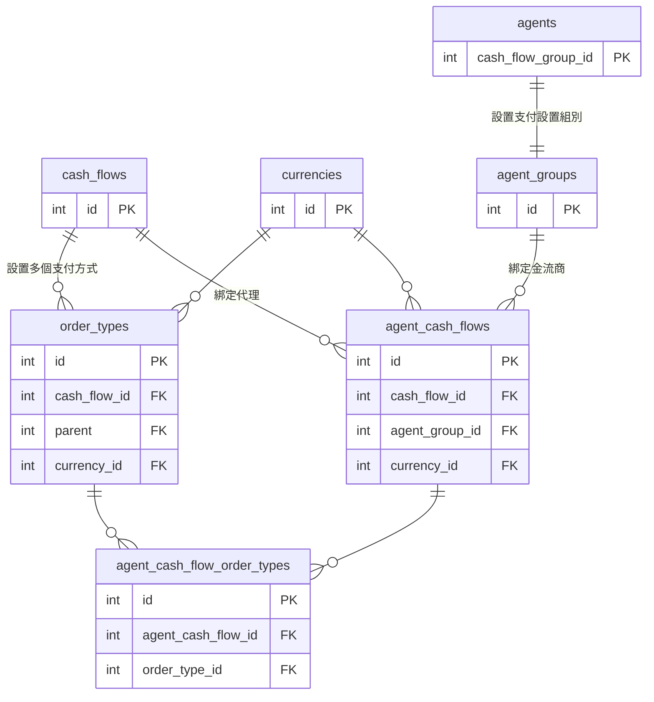
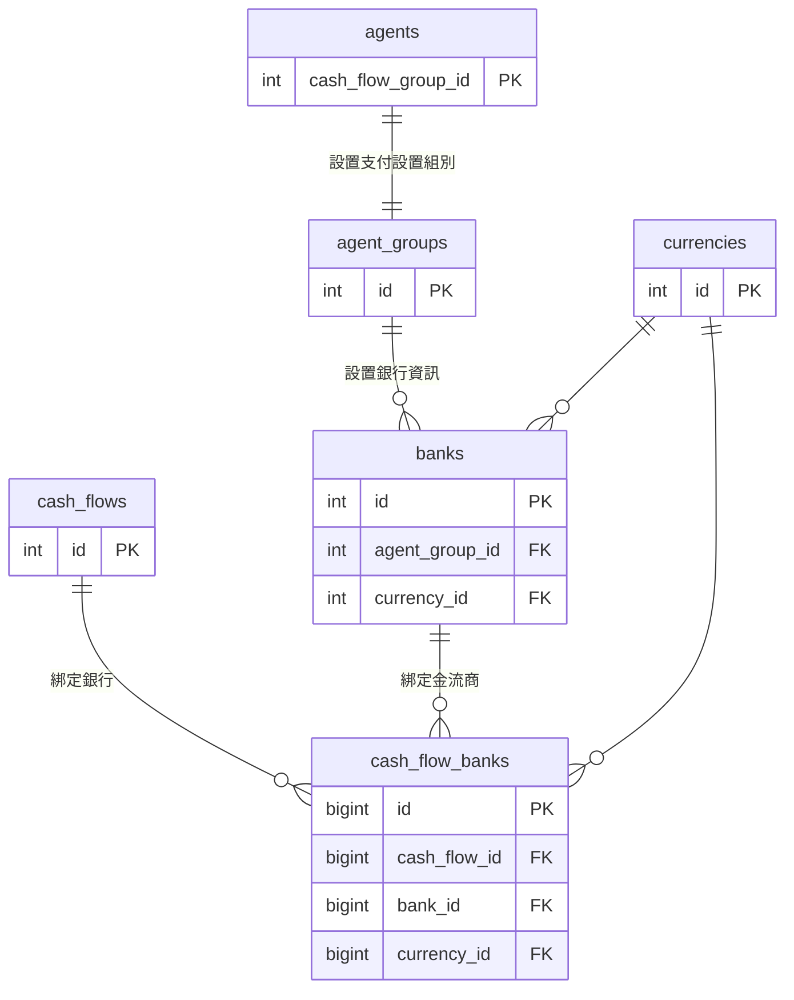

# 金流商接入完整操作流程

## 文件版本

最新版本：**v1.11**（2026-10-07）— 附錄「常見缺陷類型」擴充為十二類。詳見 [CHANGELOG](CHANGELOG.md)。

## 概述

本文件說明如何將新金流商接入系統並配置給代理使用，帶領新成員逐步完成從開發到上線的完整流程。  
為方便後續說明，以下先定義本文使用的專有名詞：

- **Deposit**：儲值／充值，會員向平台存款的流程（平台收款）
- **DepositCallback**：儲值回調，金流商在代收交易完成後主動通知平台結果的機制
- **Withdrawal**：提款／洗分，平台支付款項給會員或代理的流程（平台付款）
- **WithdrawalCallback**：提款回調，金流商在代付交易完成後主動通知平台結果的機制
- **Cash Flow**：金流商，第三方支付服務提供商（如 EpicPay）
- **Agent Cash Flow**：代理商戶，代理在特定金流商下的配置實例；一個金流商可對應多個代理商戶
- **OrderType**：代收渠道，金流商支援的支付方式（如 QR Code、FPX、網銀轉帳），對應 `order_types` 資料表
- **Provider**：系統中為金流商開發的程式碼模組，位於 `app/Services/Payment/Providers/{Name}/`，包含代收與代付的完整實作
- **回調（Callback）**：金流商以 HTTP POST 主動推送交易結果至平台的機制；屬於非同步通知，平台須實作對應的接收端點
- **沙盒環境（Sandbox）**：金流商提供的測試環境，使用虛擬商戶帳號與假交易，不會產生真實金流
- **agent_group_id**：代理所屬的業務群組 ID，`agent_cash_flows` 透過此欄位與代理群組關聯
- **cash_flow_group_id**：記錄在 `agents` 表，代表該代理使用哪一個金流商群組；必須與 `agent_cash_flows.agent_group_id` 一致，代理才能正確取得金流商資訊

整體接入流程共分為四個主要工作階段，依序如下：
1. 配置金流商：一組重要設置，以驅動系統支援該金流商代收或代付之服務
2. 開發金流商所屬的服務器 Driver
3. 測試與提交驗收
4. 上線

接下來的章節會對這四個主題詳加描述。

## 前置說明

### 涉及的資料表
金流商的配置、帳號餘額與交易紀錄分佈於下列各資料表，理解這些表的關係有助於開發金流回調 (Callback) 邏輯。

| 類別 | 資料表 | 說明 |
| :--- | :--- | :--- |
| **配置** | `cash_flows` | 金流商主表，儲存金流商基本資訊與幣別配置 |
| **配置** | `order_types` | 金流商渠道表，儲存代收渠道配置 |
| **配置** | `agent_cash_flows` | 代理商戶金流配置表，代理在特定金流商下的商戶設定 |
| **配置** | `agent_cash_flow_order_types` | 代理商戶渠道配置表，決定代理可用的支付方式 |
| **配置** | `banks` | 銀行基準資料表，儲存系統支援的各國銀行資訊 |
| **配置** | `cash_flow_banks` | 金流商銀行配置表，儲存金流商與銀行代碼的映射關係 |
| **配置** | `agents` | 代理主表，紀錄代理所屬的金流組別 (`cash_flow_group_id`) |
| **配置** | `agent_groups` | 代理組別表，用於關聯代理與金流配置實例 |
| **帳號** | `members` | 會員主表，儲存會員基本資訊與餘額 |
| **帳號** | `member_wallets` | 會員錢包表，紀錄會員各項幣別的餘額資訊 |
| **紀錄** | `orders` | 儲值訂單表，紀錄所有代收 (Deposit) 交易內容與狀態 |
| **紀錄** | `withdrawal_orders` | 提款訂單表，紀錄所有代付 (Withdrawal) 交易內容與狀態 |

### ERD 模型圖

若要讓代理正確取得金流商資訊，必須確保 `agent_cash_flows.agent_group_id` 與 `agents.cash_flow_group_id` 的值一致。

#### 代收渠道相關

#### 代付銀行相關

> 指令速查與核心文件結構說明，請參閱 [附錄：技術參考](附錄-技術參考.md)。

---

## 前置準備

1. 向 PM 請求各項文件之權限：
   - 對外域名
   - ip 白名單
   - oneDrive 存取權限
   - 第三方後台列表文件
   - 各站代理對照表
2. 找到欲接入的站是哪一個，並找出該站主要的代理資訊，記下來，之後會用到。
3. 加入金流商對接的溝通群組。
4. 請金流商加入 ip 白名單（選用）
5. 接著向金流商取得以下資訊：
- [ ] 金流商英文代號（大駝峰格式，例如：`EpicPay`）與中文名稱
- [ ] 支援代收 / 代付 / 兩者皆有）
- [ ] 支援的幣別（MYR / THB / VND / INR / PHP 等）
- [ ] API 文檔與測試商戶資訊
- [ ] 支付渠道列表（QR Code / 網銀轉帳 / FPX 等）及各渠道的金額限制（min_amount / max_amount）
- [ ] 若支援銀行轉帳，需取得代收與代付的支援銀行清單

---

## 一、配置金流商

詳見 [1-配置金流商](1-配置金流商.md)。

---

## 二、開發金流商所屬的服務器 Driver

詳見 [2-開發金流商Driver](2-開發金流商Driver.md)。

---

## 三、測試與提交驗收

詳見 [3-測試與提交驗收](3-測試與提交驗收.md)。

---

## 四、上線

詳見 [4-上線](4-上線.md)。

---

## 章節檢查清單

完成金流商接入後，請依照以下開發順序進行最終檢查：

### 第一階段：配置金流商
詳見 [1-配置金流商](1-配置金流商.md)

- [ ] **步驟二**：登記 `Data/cash_flows.php`
    - [ ] CashFlow ID 唯一且未被佔用
    - [ ] 設定正確的 type（1=代收, 3=代付）
    - [ ] 填了 `third_party_code`（`D_` 代收、`W_` 代付）
    - [ ] 配置各幣別的預設匯率和金額限制
- [ ] **步驟三**：設定渠道配置 `Data/providers/{Provider}.php`
    - [ ] 代收渠道 (deposit) 配置完整（name, key, type, currency）
    - [ ] 金額限制 (min/max_amount) 設定正確
    - [ ] 代付銀行 (withdrawal) 配置完整且包含正確的銀行代碼（如需要）
- [ ] **步驟四**：執行同步 `php artisan cash-flow:sync`
    - [ ] 先用 `--dry-run` 模式驗證無誤
    - [ ] 正式執行後，資料庫 `cash_flows`、`order_types` 等表數據正確寫入
- [ ] **步驟五**：建立代理商戶配置 `php artisan agent:add-agent-cash-flow`
    - [ ] 指定正確的 agent、cashflow、currency
    - [ ] 確認 `agent_cash_flows` 與 `agent_cash_flow_order_types` 建立成功
    - [ ] 代理後台能正確看到該金流商選項

### 第二階段：開發金流商 Driver
詳見 [2-開發金流商Driver](2-開發金流商Driver.md)

- [ ] **步驟一**：在 `config/payment.php` 註冊 Driver 類別
    - [ ] Key 為大寫，Value 為完整的命名空間路徑
- [ ] **步驟二**：執行 `php artisan make:payment` 建立架構
    - [ ] 建立的 5-6 個類別檔案均存在於正確目錄
- [ ] **實作業務邏輯**：
    - [ ] `{Name}Trait`：已實作 API 所需的簽名 (sign) 演算法
    - [ ] `Deposit`：已組裝正確請求參數並能回傳支付連結 (URL/Form)
    - [ ] `DepositCallback`：已實作回調驗章、狀態判斷與金額驗證
    - [ ] `Withdrawal`：已實作代付請求並宣告正確的 `$orderPrefix`（如需要）
    - [ ] `WithdrawalCallback`：已實作代付回調邏輯與狀態變更（如需要）

### 第三階段：測試與驗收
詳見 [3-測試與提交驗收](3-測試與提交驗收.md)

- [ ] **✅ 功能驗證**：
    - [ ] **代收**：可以正常跳轉支付頁面，模擬回調後訂單狀態更新為「已上分」
    - [ ] **代付**：代付請求成功送出，模擬回調後訂單狀態更新為「已付款」
    - [ ] **後台管理**：對應的訂單管理介面（支付訂單、儲值/洗分審核）能查看到交易
    - [ ] **回調響應**：回傳給金流商的字串（如 `OK` 或 `success`）符合 API 規範

---

## 常見問題(待編輯)

遇到問題時，請查閱 [故障排除與常見問題](故障排除與常見問題.md)。

## 附錄(待編輯)

完整的配置範例、指令速查與核心文件結構，請參閱 [附錄：技術參考](附錄-技術參考.md)。

接金流商時反覆出現的十二類缺陷（代付與代收的狀態判斷、回調真實性、金額比對、敏感資訊外洩、代付回調找單、放款前反查、請求內容、錯誤處理、文件失準），以及每一類的正確做法與檢查方法，請參閱 [附錄：常見缺陷類型](附錄-常見缺陷類型.md)。開發 Driver 前先讀一遍，提交驗收前再照文末的檢查順序自查。
