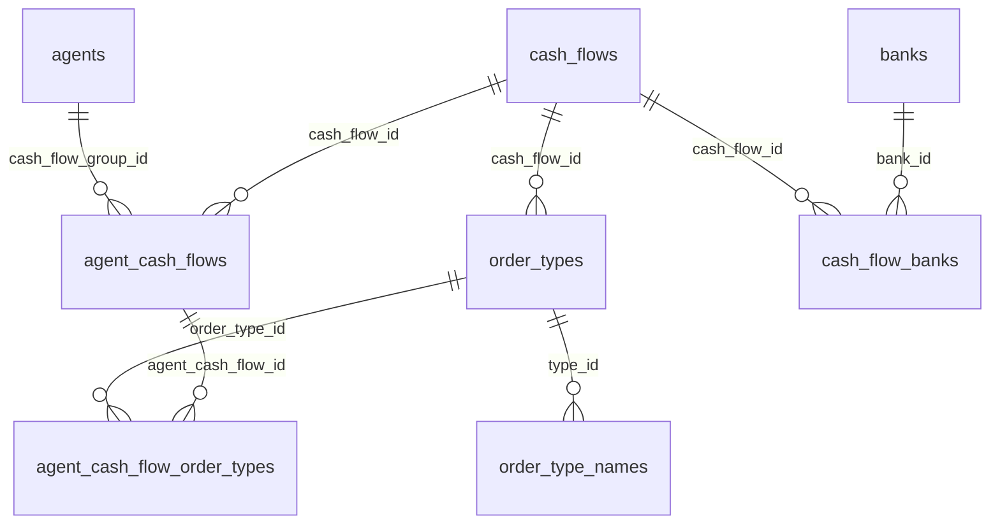

# 金流代收／代付 資料模型速覽

> 給新人 5 分鐘看懂這組表怎麼串。表名沿用現況（正規化程度高），本文件補「白話對照＋常用查詢」。

## ER 關聯



## 中英對照

| 表 | 白話 | 關鍵欄位 |
|---|---|---|
| `agents` | 代理 | id |
| `cash_flows` | 金流商 | id, name, type（1=代收 3=代付）, status |
| `order_types` | 代付／代收類型（支付方式） | id, cash_flow_id, name, status |
| `order_type_names` | 支付方式前端多語系名稱 | id, type_id, language_id, name, **cash_flow_id（本案新增捷徑）** |
| `banks` | 銀行 | id, name, code |
| `agent_cash_flows`（ACF） | 代理關聯的金流商商戶配置 | id, cash_flow_id, agent_group_id, currency_id, cost, status |
| `agent_cash_flow_order_types`（ACFOT） | 代理關聯的金流商支付方式 | id, agent_cash_flow_id, order_type_id, **cash_flow_id（本案 repurpose）**, status, cost |

## 常用查詢（以 TTPay cash_flow_id=125 為例）

```sql
-- 該金流商所有支付方式上下架（本案捷徑：ACFOT 直接帶 cash_flow_id）
SELECT id, agent_cash_flow_id, order_type_id, status
FROM agent_cash_flow_order_types WHERE cash_flow_id = 125;

-- 該金流商所有多語系顯示名（本案捷徑）
SELECT id, type_id, language_id, name
FROM order_type_names WHERE cash_flow_id = 125;

-- 渠道（ACF）層設定
SELECT id, agent_group_id, currency_id, cost, status
FROM agent_cash_flows WHERE cash_flow_id = 125;
```

> 維運改上下架／改名走 artisan 命令（禁應用層裸寫、使用者本人在 DB GUI 手動 SQL 不受此限）：
> - `cash-flow:channel-status 125`（查樹狀）／`... --acfot=<id> --set-status=0 --force`（改 ACFOT 上下架）／`... --acf=<id> --set-status=0 --force`（改整條 ACF 渠道）
> - `cash-flow:order-type-name 125`（查多語系名）／`... --otn=<id> --set-name=<新名> --force`（改單筆）
> - `cash-flow:backfill-cash-flow-id --execute`（`cash-flow:sync` 後補 cash_flow_id 守護，冪等）

## 兩個容易混淆的點

1. **銀行掛在 `cash_flow_banks`（cfb），不經過 ACFOT**。cfb 早有 `cash_flow_id`，「從金流商查銀行」本就一步到位；ACFOT 是「支付方式」軸，與銀行軸平行不互 join。
2. **`agent_cash_flows` 也有一個 `cash_flow_info_id` 欄位**（dead、本案不動）；ACFOT 的 `cash_flow_info_id` 才是本案 repurpose 成 `cash_flow_id` 的那個。兩者同名但不同表，別搞混。
