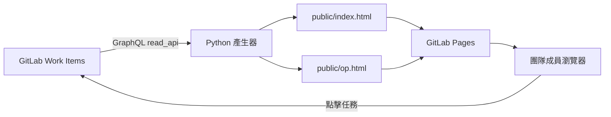

# GitLab Tools 專案介紹

## 專案定位

GitLab Tools 是一個輕量的內部報表專案。它從 GitLab Work Items 讀取即時資料，將團隊任務與維運工單整理成兩個互動式靜態看板，再透過 GitLab Pages 發布。

這個專案主要解決兩個問題：

1. GitLab 原始清單不容易快速看出每位成員的負載、期限與未分配工作。
2. 維運工單需要額外呈現 SLA、停滯時間、站點風險與處理人負載。

看板只提供彙整與導覽，不會修改 GitLab Work Items。使用者可以從卡片連回 GitLab 查看或更新原始資料。

## 使用者入口

- 任務看板：`http://example.invalid:1688/`
- 維運戰情室：`http://example.invalid:1688/op.html`

Pages 已啟用 GitLab 存取控制；未登入的使用者會先被導向 GitLab 驗證。

## 兩個看板

### 成員任務看板

資料來源預設為 `target/ticket_tasks`，產出檔案是 `public/index.html`。

主要功能：

- 顯示開啟中的任務總數、參與成員、今日到期、逾期與未分配數量。
- 依成員呈現工作量及期限分布。
- 依成員、到期狀態或專案切換任務欄位。
- 在月曆或週曆中查看跨日任務與處理人姓名、頭像；任務依處理人固定配色，多人共同指派以分段色彩呈現。
- 日曆可依成員、專案及期限狀態篩選，任務條底線保留期限狀態提示。
- 週六、週日與台灣國定假日使用不同日期底色；假日名稱採用人事行政總處 2025–2027 官方辦公日曆快照。
- 將完全沒有開始日與到期日的項目集中列在未排程區。
- 篩選今日到期、逾期或無到期日的任務。
- 點選成員聚焦其任務。
- 支援多人共同指派；任務會計入每位成員的負載，但全域任務總數只計一次。

期限分類如下：

| 分類 | 規則 |
| --- | --- |
| 逾期 | 到期日早於資料日 |
| 今日 | 到期日等於資料日 |
| 2 日內 | 到期日在未來兩日內 |
| 其後 | 到期日在兩日後 |
| 無期限 | 沒有到期日 |

### 維運戰情室

資料來源預設為 `target/op_tickets`，產出檔案是 `public/op.html`。

主要功能：

- SLA 燃燒跑道：依已使用 SLA 比例排序 P1、P2 工單。
- 需跟進：列出未指派、超時或長時間未更新的工單。
- 處理人負載：呈現每人持有工單數、告急數與最老工單。
- 站點健康：依工單量、超時數與平均老化時間估算風險。
- 最老未結工單：快速找出長期未關閉項目。

目前規則：

| 項目 | 規則 |
| --- | --- |
| P1 SLA | 24 小時 |
| P2 SLA | 3 個工作日 |
| P3 SLA | 不計算 SLA |
| 停滯 | 12 小時未更新 |
| 時區 | 台北固定時區 UTC+8 |

站點名稱取自標題開頭的方括號，例如 `[SITE]`；優先級取自 GitLab labels。

## 系統架構



專案刻意保持簡單：

- 不需要資料庫或常駐後端。
- 不需要 JavaScript build system。
- Python 僅使用標準函式庫。
- 資料直接嵌入靜態 HTML，瀏覽頁面時不再呼叫 GitLab API。
- Token 只存在於 CI runner，不會出現在 Pages 產物中。

## 資料生成流程

1. GitLab push 或排程啟動 `pages` job。
2. CI 執行 Python 編譯檢查與單元測試。
3. 產生器使用 `GITLAB_READ_TOKEN` 呼叫 GitLab GraphQL API。
4. 每頁讀取最多 100 筆 Work Items，利用 cursor 持續分頁直到完成。
5. 完整資料經轉換與安全編碼後嵌入 HTML。
6. HTML 以原子方式寫入 `public/`，檔案權限固定為 `0644`。
7. GitLab 將 `public/` artifact 發布至 Pages。

任一分頁、測試或產生步驟失敗，整個 job 都會失敗，不會發布看似正常但資料不完整的新版看板。

## 可靠性與安全設計

### 完整分頁

GitLab GraphQL 採 cursor pagination。共用 client 會檢查：

- `hasNextPage` 與 `endCursor` 是否有效。
- cursor 是否確實前進。
- 不同頁面是否出現重複 IID。
- 是否超過 100 頁安全上限。

### 暫時性錯誤重試

HTTP `429`、`502`、`503`、`504` 與暫時性網路錯誤會有限次數重試。權限、schema 或 GraphQL 資料錯誤不會盲目重試。

### 輸出安全

- 嵌入 `<script>` 的 JSON 會轉義可能提前結束 script 的字元。
- 顯示名稱、標題、站點及專案等動態內容在插入 HTML 前會編碼。
- 前端索引使用無 prototype 的 object，並為 username 加 namespace，避免特殊名稱與 JavaScript 內建屬性衝突。
- 任務連結使用固定 GitLab base URL 與數字 IID 組成。

## 程式結構

| 檔案 | 責任 |
| --- | --- |
| `gitlab_api.py` | GraphQL 請求、分頁、重試、安全 JSON、原子寫檔 |
| `tw_holidays.py` | 人事行政總處官方辦公日曆的台灣國定假日快照 |
| `generate_board.py` | 轉換任務資料並生成成員任務看板 |
| `generate_op.py` | 轉換維運資料並生成維運戰情室 |
| `tests/test_gitlab_api.py` | 分頁、錯誤處理、輸出安全與檔案權限測試 |
| `tests/test_generators.py` | 指派人與看板資料轉換測試 |
| `.gitlab-ci.yml` | 測試、生成與 Pages artifact 設定 |

## 設定

| 環境變數 | 用途 | 預設值 |
| --- | --- | --- |
| `GITLAB_READ_TOKEN` | 具有 `read_api` 權限的存取 token | 必填 |
| `CI_SERVER_URL` | GitLab 根網址 | `http://example.invalid:1688` |
| `BOARD_PROJECT` | 任務看板來源專案 | `target/ticket_tasks` |
| `OP_PROJECT` | 維運戰情室來源專案 | `target/op_tickets` |

`GITLAB_READ_TOKEN` 應在 GitLab CI/CD Variables 中設為 masked、protected，不應提交到 repository。

## 本地開發與驗證

```bash
export GITLAB_READ_TOKEN=[REDACTED]'
export CI_SERVER_URL='http://example.invalid:1688'

python3 -m py_compile gitlab_api.py tw_holidays.py generate_board.py generate_op.py
python3 -m unittest discover -v
python3 generate_board.py
python3 generate_op.py
```

成功後會產生：

```text
public/
├── index.html
└── op.html
```

`public/` 是生成物，已由 `.gitignore` 排除。

## 維運與故障排查

### 看板任務數與 GitLab 不一致

1. 查看 job log 中每頁與總筆數。
2. 確認來源專案與篩選條件是 `opened`。
3. 確認 Work Item 是否剛被關閉或重新開啟。
4. 確認 pipeline 使用的是最新 commit。

### Pipeline 在執行腳本前失敗

目前 runner 版本較舊，只能使用相容 Docker manifest 的 image。`.gitlab-ci.yml` 已固定使用驗證過的 `google/cloud-sdk:522.0.0`。若更換 image，應先確認舊 Kubernetes runner 能夠拉取。

### GraphQL 權限錯誤

確認 token：

- 尚未過期或撤銷。
- 具有 `read_api` 權限。
- 能讀取 `BOARD_PROJECT` 與 `OP_PROJECT`。

### Pages 顯示舊資料

1. 確認最新 pipeline 與 `pages` job 成功。
2. 查看頁面上的「最後更新」時間。
3. 重新載入頁面；HTML 本身是 pipeline 產生時的快照。
4. 檢查 GitLab Pipeline Schedule 是否正常啟用。實際更新頻率由排程設定決定。

## 變更原則

- 資料完整性優先；寧可 pipeline 失敗，也不發布部分資料。
- 看板保持唯讀，不由 Pages 直接修改 GitLab。
- 新增統計規則時，應同步更新測試與本文件。
- 修改 GraphQL 欄位或分頁行為後，應以超過 100 筆的資料執行 smoke test。
