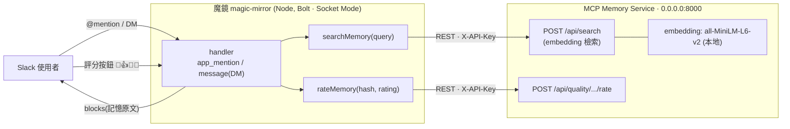
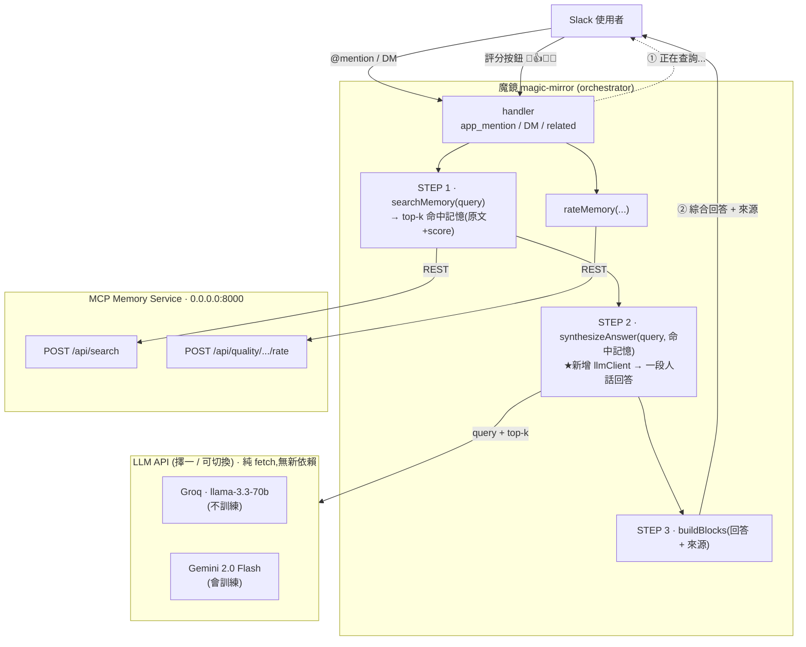
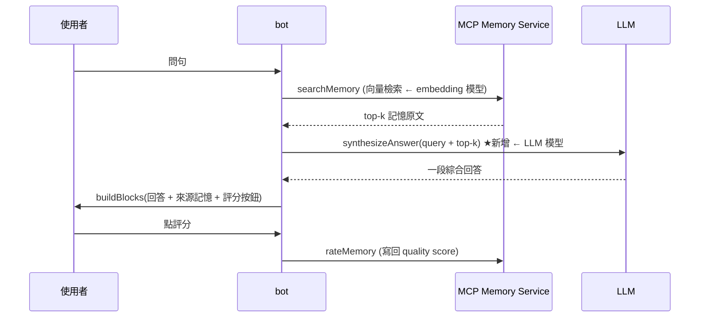

# 魔鏡 magic-mirror 架構與 LLM 整合規劃

> 目的：記錄 bot 目前架構，以及「在 bot 層接入 LLM（RAG）」的設計規劃。
> LLM 放在 orchestration 層（bot），memory service 維持純資料庫角色。

> **LLM 供應商（2026-07-08 定案）**：改用**本機 `claude -p`（Claude Code CLI），預設 `haiku`**，
> 取代先前規劃的 siraya.ai/Gemini。`claude -p` 於中性 cwd 純文字推理、不授予工具、不外送憑證，
> 消除「內部記憶送外部供應商」的隱私風險。詳見
> [docs/superpowers/specs/2026-07-08-magic-mirror-claude-p-llm-design.md](docs/superpowers/specs/2026-07-08-magic-mirror-claude-p-llm-design.md)。

## 現況架構（尚未接 LLM）



目前流程：
```
@mention / DM → searchMemory() → 把記憶原文直接貼成 blocks
```
缺點：回傳的是記憶原文堆疊，使用者要自己讀；多筆結果無法綜合。

## 加 LLM 後的架構（RAG，LLM 在 bot 層）



加 LLM 後流程：
```
@mention / DM → searchMemory() → 把 query + 命中的記憶丟給 LLM
              → LLM 綜合成一段直接回答 → 顯示回答 +(可保留)來源記憶 + 評分按鈕
```

## 資料流（一次問答）



## 關鍵設計重點

| 項目 | 說明 |
|------|------|
| **職責分離** | LLM 只在 bot 層做「綜合回答」；memory service 仍只負責 embedding 檢索 + 評分儲存，完全不碰 LLM。 |
| **新增的唯一元件** | `src/llmClient.js` → `synthesizeAnswer(query, results)`，純 `fetch`，不裝新套件。 |
| **改動的位置** | 三個 handler（`app_mention`、DM、`search_related`）的「`searchMemory` 之後」插一步；`buildBlocks` 最上方加「綜合回答」區塊。 |
| **LLM 拿到什麼** | 只拿 `searchMemory` 回來的 top-k 記憶當 context（RAG），**不是**整個記憶庫；省 token、降低幻覺。 |
| **評分機制不變** | 現有的 🎯👍🤔❌ 仍評「檢索品質」（content_hash），與 LLM 回答品質是兩件事。 |
| **延遲** | Socket Mode 無 3 秒限制；已先回「正在查詢...」，LLM 再慢也只是第二則訊息晚一點到。 |

## 兩個待決定（不急，動工前再定）

1. **顯示方式**
   - 回答在上、來源在下（完整，可驗證來源）
   - 只給 LLM 回答（簡潔，失去來源可追溯性）
2. **Provider**
   - **Groq**（`llama-3.3-70b-versatile`）：低延遲、不拿資料訓練，適合內部營運資料。
   - **Gemini 2.0 Flash**：額度大、context 大（1M）、中文佳，但免費 tier 會用 prompt 訓練。
   - 兩家可切換：`llmClient` 用 `LLM_PROVIDER` 環境變數切換。

## 動工時的待辦（規劃，尚未實作）

- [ ] 新增 `src/llmClient.js`：`synthesizeAnswer(query, results)`
- [ ] 三個 handler 在 `searchMemory()` 後插入 `synthesizeAnswer()`
- [ ] `buildBlocks` 最上方加「LLM 綜合回答」區塊
- [ ] `.env.example` 加 `LLM_PROVIDER` / `GROQ_API_KEY` 或 `GEMINI_API_KEY` / `LLM_MODEL`
- [ ] prompt 設計：把 top-k 記憶塞進 context，並要求「找不到就說不知道、不要編造」
- [ ] 錯誤處理：LLM 失敗時 fallback 回目前的記憶原文顯示
